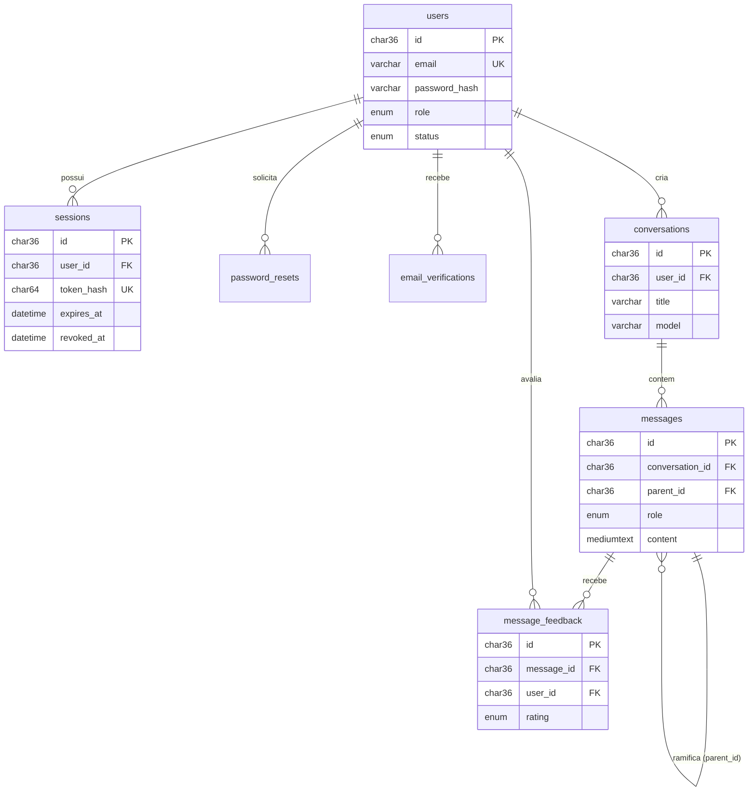

# Documentação do Banco de Dados: Chat de IA

Banco de dados MySQL para um chat de IA via web, com cadastro, login, histórico de conversas e mensagens.

- **SGBD:** MySQL 8+
- **Engine:** InnoDB
- **Charset:** `utf8mb4` / `utf8mb4_unicode_ci` (suporta acentos e emojis)
- **Nome do banco:** `ai_chat`
- **Escopo atual:** usuários, sessões e histórico de mensagens. Assinaturas, planos e contagem de tokens ficam fora desta versão.

---

## Sumário

1. [Visão geral](#1-visão-geral)
2. [Diagrama de relacionamentos](#2-diagrama-de-relacionamentos)
3. [Tabelas](#3-tabelas)
4. [Fluxos principais](#4-fluxos-principais)
5. [Consultas comuns](#5-consultas-comuns)
6. [Segurança e privacidade](#6-segurança-e-privacidade)
7. [Evolução futura](#7-evolução-futura)
8. [Script SQL completo](#8-script-sql-completo)

---

## 1. Visão geral

| Grupo | Tabelas | Função |
|---|---|---|
| Usuários | `users` | Cadastro e dados de acesso |
| Autenticação | `sessions`, `password_resets`, `email_verifications` | Login, logout, recuperação de senha, verificação de e-mail |
| Conversas | `conversations`, `messages` | Histórico do chat |
| Avaliação | `message_feedback` | Joinha positivo ou negativo nas respostas da IA |

Todos os IDs são **UUID** (`CHAR(36)`), gerados pela API (por exemplo, `uuid.uuid4()` em Python). Isso evita expor IDs sequenciais e facilita a migração futura.

---

## 2. Diagrama de relacionamentos



Versão em texto:

```
users ─┬─< sessions
       ├─< password_resets
       ├─< email_verifications
       ├─< conversations ─< messages ─< message_feedback
       └─< message_feedback
```

---

## 3. Tabelas

### 3.1 `users`

Contas de usuário.

| Coluna | Tipo | Nulo | Padrão | Descrição |
|---|---|---|---|---|
| `id` | CHAR(36) | Não | | PK. UUID gerado pela API |
| `name` | VARCHAR(120) | Não | | Nome de exibição |
| `email` | VARCHAR(255) | Não | | E-mail de login. **Único** |
| `password_hash` | VARCHAR(255) | Não | | Hash da senha (Argon2id ou bcrypt). Nunca a senha pura |
| `avatar_url` | VARCHAR(500) | Sim | | URL da foto de perfil |
| `role` | ENUM('user','admin') | Não | `user` | Permissão no sistema |
| `status` | ENUM('active','suspended','deleted') | Não | `active` | Situação da conta |
| `email_verified_at` | DATETIME | Sim | | Preenchido quando o e-mail é confirmado |
| `last_login_at` | DATETIME | Sim | | Último login bem-sucedido |
| `created_at` | DATETIME | Não | `CURRENT_TIMESTAMP` | Data de cadastro |
| `updated_at` | DATETIME | Não | `CURRENT_TIMESTAMP` (auto) | Última alteração |
| `deleted_at` | DATETIME | Sim | | Exclusão lógica (soft delete) |

**Índices:** `PRIMARY KEY (id)`, `UNIQUE (email)`

---

### 3.2 `sessions`

Sessões de login. Cada linha representa um refresh token ativo, permitindo logout e revogação em um dispositivo específico.

| Coluna | Tipo | Nulo | Padrão | Descrição |
|---|---|---|---|---|
| `id` | CHAR(36) | Não | | PK |
| `user_id` | CHAR(36) | Não | | FK para `users.id` |
| `token_hash` | CHAR(64) | Não | | SHA-256 do refresh token. **Único** |
| `user_agent` | VARCHAR(500) | Sim | | Navegador e dispositivo |
| `ip_address` | VARCHAR(45) | Sim | | IP (comporta IPv6) |
| `created_at` | DATETIME | Não | `CURRENT_TIMESTAMP` | Início da sessão |
| `expires_at` | DATETIME | Não | | Validade do refresh token |
| `revoked_at` | DATETIME | Sim | | Preenchido no logout ou revogação |

**Índices:** `PRIMARY KEY (id)`, `UNIQUE (token_hash)`, `KEY (user_id)`
**Chave estrangeira:** `user_id` → `users.id` (`ON DELETE CASCADE`)

Uma sessão é válida quando `revoked_at IS NULL AND expires_at > NOW()`.

---

### 3.3 `password_resets`

Tokens de recuperação de senha.

| Coluna | Tipo | Nulo | Padrão | Descrição |
|---|---|---|---|---|
| `id` | CHAR(36) | Não | | PK |
| `user_id` | CHAR(36) | Não | | FK para `users.id` |
| `token_hash` | CHAR(64) | Não | | Hash do token enviado por e-mail. **Único** |
| `created_at` | DATETIME | Não | `CURRENT_TIMESTAMP` | Criação |
| `expires_at` | DATETIME | Não | | Validade (sugestão: 30 a 60 minutos) |
| `used_at` | DATETIME | Sim | | Preenchido quando o token é usado (uso único) |

**Índices:** `PRIMARY KEY (id)`, `UNIQUE (token_hash)`, `KEY (user_id)`
**Chave estrangeira:** `user_id` → `users.id` (`ON DELETE CASCADE`)

---

### 3.4 `email_verifications`

Tokens de confirmação de e-mail após o cadastro.

| Coluna | Tipo | Nulo | Padrão | Descrição |
|---|---|---|---|---|
| `id` | CHAR(36) | Não | | PK |
| `user_id` | CHAR(36) | Não | | FK para `users.id` |
| `token_hash` | CHAR(64) | Não | | Hash do token enviado por e-mail. **Único** |
| `created_at` | DATETIME | Não | `CURRENT_TIMESTAMP` | Criação |
| `expires_at` | DATETIME | Não | | Validade (sugestão: 24 horas) |
| `used_at` | DATETIME | Sim | | Quando foi confirmado |

**Índices:** `PRIMARY KEY (id)`, `UNIQUE (token_hash)`, `KEY (user_id)`
**Chave estrangeira:** `user_id` → `users.id` (`ON DELETE CASCADE`)

---

### 3.5 `conversations`

Cada conversa (chat) de um usuário. É o que aparece na barra lateral do histórico.

| Coluna | Tipo | Nulo | Padrão | Descrição |
|---|---|---|---|---|
| `id` | CHAR(36) | Não | | PK |
| `user_id` | CHAR(36) | Não | | FK para `users.id` (dono da conversa) |
| `title` | VARCHAR(200) | Não | `Nova conversa` | Título exibido no histórico |
| `model` | VARCHAR(100) | Sim | | Modelo de IA usado na conversa |
| `is_pinned` | TINYINT(1) | Não | `0` | Conversa fixada no topo |
| `is_archived` | TINYINT(1) | Não | `0` | Conversa arquivada |
| `created_at` | DATETIME | Não | `CURRENT_TIMESTAMP` | Criação |
| `updated_at` | DATETIME | Não | `CURRENT_TIMESTAMP` (auto) | Atualizado a cada mudança, usado para ordenar |
| `deleted_at` | DATETIME | Sim | | Exclusão lógica |

**Índices:** `PRIMARY KEY (id)`, `KEY idx_conv_user_updated (user_id, updated_at DESC)`
**Chave estrangeira:** `user_id` → `users.id` (`ON DELETE CASCADE`)

O índice composto acelera a listagem do histórico, que sempre filtra por usuário e ordena pela data.

---

### 3.6 `messages`

Mensagens trocadas dentro de uma conversa.

| Coluna | Tipo | Nulo | Padrão | Descrição |
|---|---|---|---|---|
| `id` | CHAR(36) | Não | | PK |
| `conversation_id` | CHAR(36) | Não | | FK para `conversations.id` |
| `parent_id` | CHAR(36) | Sim | | FK para `messages.id`. Mensagem anterior na árvore (editar e regenerar) |
| `role` | ENUM('system','user','assistant') | Não | | Quem enviou a mensagem |
| `content` | MEDIUMTEXT | Não | | Texto da mensagem (Markdown), até 16 MB |
| `model` | VARCHAR(100) | Sim | | Modelo que gerou a resposta (apenas `assistant`) |
| `status` | ENUM('complete','error','stopped') | Não | `complete` | Estado da resposta |
| `error_message` | VARCHAR(500) | Sim | | Detalhe do erro, se `status = 'error'` |
| `created_at` | DATETIME | Não | `CURRENT_TIMESTAMP` | Data de envio |

**Índices:** `PRIMARY KEY (id)`, `KEY idx_msg_conv_created (conversation_id, created_at)`, `KEY idx_msg_parent (parent_id)`
**Chaves estrangeiras:**
- `conversation_id` → `conversations.id` (`ON DELETE CASCADE`)
- `parent_id` → `messages.id` (`ON DELETE SET NULL`)

**Valores de `role`:**

| Valor | Uso |
|---|---|
| `system` | Instruções internas enviadas à IA (prompt de sistema) |
| `user` | Mensagem digitada pelo usuário |
| `assistant` | Resposta da IA |

**Valores de `status`:**

| Valor | Significado |
|---|---|
| `complete` | Mensagem finalizada normalmente |
| `error` | Falha ao gerar a resposta |
| `stopped` | Usuário interrompeu a geração |

**Sobre `parent_id`:** permite que a conversa seja uma árvore. Ao editar uma pergunta ou regenerar uma resposta, cria-se uma nova mensagem com o mesmo `parent_id` da original, formando um ramo alternativo. Se você não for usar isso agora, deixe sempre `NULL`.

---

### 3.7 `message_feedback`

Avaliação do usuário sobre as respostas da IA (opcional).

| Coluna | Tipo | Nulo | Padrão | Descrição |
|---|---|---|---|---|
| `id` | CHAR(36) | Não | | PK |
| `message_id` | CHAR(36) | Não | | FK para `messages.id` |
| `user_id` | CHAR(36) | Não | | FK para `users.id` |
| `rating` | ENUM('up','down') | Não | | Positivo ou negativo |
| `comment` | VARCHAR(500) | Sim | | Comentário opcional |
| `created_at` | DATETIME | Não | `CURRENT_TIMESTAMP` | Data da avaliação |

**Índices:** `PRIMARY KEY (id)`, `UNIQUE (message_id, user_id)` (um voto por usuário por mensagem)
**Chaves estrangeiras:** `message_id` → `messages.id` e `user_id` → `users.id`, ambas com `ON DELETE CASCADE`

---

## 4. Fluxos principais

### 4.1 Cadastro

1. A API valida e-mail e senha.
2. Gera o hash da senha (Argon2id ou bcrypt).
3. `INSERT` em `users`.
4. (Opcional) `INSERT` em `email_verifications` e envio do e-mail com o token.

### 4.2 Login

1. Busca o usuário por `email` e confere o hash da senha.
2. Verifica `status = 'active'`.
3. Gera o refresh token, calcula o SHA-256 e faz `INSERT` em `sessions`.
4. Atualiza `users.last_login_at`.
5. Devolve ao front-end o JWT de acesso (vida curta, de 10 a 15 minutos) e o refresh token.

### 4.3 Renovar acesso

1. Front-end envia o refresh token.
2. A API calcula o hash e procura em `sessions` com `revoked_at IS NULL AND expires_at > NOW()`.
3. Se válido, emite um novo JWT de acesso (e, idealmente, rotaciona o refresh token).

### 4.4 Logout

Preenche `sessions.revoked_at` com a data atual.

### 4.5 Recuperação de senha

1. Usuário informa o e-mail. A API cria uma linha em `password_resets` e envia o token por e-mail.
2. Usuário abre o link com o token. A API confere hash, `expires_at` e `used_at IS NULL`.
3. Atualiza `users.password_hash`, marca `used_at` e revoga todas as sessões do usuário.

### 4.6 Enviar mensagem

```
Usuário envia texto
        │
        ▼
Existe conversation_id?
   ├── Não → INSERT em conversations (title provisório)
   └── Sim → valida que a conversa pertence ao user_id logado
        │
        ▼
INSERT em messages (role = 'user')
        │
        ▼
API busca as últimas N mensagens e envia à IA
        │
        ▼
INSERT em messages (role = 'assistant', status = 'complete')
        │
        ▼
UPDATE conversations SET updated_at = NOW() (e título, se for a 1ª troca)
```

A IA não guarda memória entre chamadas. O contexto de cada resposta é montado a partir do histórico salvo em `messages`.

---

## 5. Consultas comuns

**Listar o histórico (barra lateral):**
```sql
SELECT id, title, is_pinned, updated_at
FROM conversations
WHERE user_id = ?
  AND deleted_at IS NULL
  AND is_archived = 0
ORDER BY is_pinned DESC, updated_at DESC
LIMIT 50;
```

**Abrir uma conversa (sempre validando o dono):**
```sql
SELECT m.id, m.parent_id, m.role, m.content, m.status, m.created_at
FROM messages m
JOIN conversations c ON c.id = m.conversation_id
WHERE m.conversation_id = ?
  AND c.user_id = ?
  AND c.deleted_at IS NULL
ORDER BY m.created_at;
```

**Últimas N mensagens para montar o contexto da IA:**
```sql
SELECT role, content
FROM (
  SELECT role, content, created_at
  FROM messages
  WHERE conversation_id = ? AND status = 'complete'
  ORDER BY created_at DESC
  LIMIT 20
) t
ORDER BY created_at;
```

**Validar sessão:**
```sql
SELECT id, user_id
FROM sessions
WHERE token_hash = ?
  AND revoked_at IS NULL
  AND expires_at > NOW();
```

**Revogar todas as sessões de um usuário:**
```sql
UPDATE sessions
SET revoked_at = NOW()
WHERE user_id = ? AND revoked_at IS NULL;
```

**Limpeza periódica de tokens vencidos:**
```sql
DELETE FROM sessions            WHERE expires_at < NOW() - INTERVAL 30 DAY;
DELETE FROM password_resets     WHERE expires_at < NOW() - INTERVAL 7 DAY;
DELETE FROM email_verifications WHERE expires_at < NOW() - INTERVAL 7 DAY;
```

---

## 6. Segurança e privacidade

- **Senhas:** somente hash (Argon2id ou bcrypt). Nunca texto puro.
- **Tokens:** refresh tokens e tokens de reset ficam apenas como hash no banco.
- **Autorização:** toda consulta de conversa ou mensagem deve filtrar pelo `user_id` do usuário autenticado, para impedir que alguém leia dados de outro.
- **SQL Injection:** use sempre queries parametrizadas (`?` ou `%s`), nunca concatenação de strings.
- **Soft delete:** `deleted_at` permite desfazer exclusões. Apague de verdade após um prazo definido.
- **LGPD:** `ON DELETE CASCADE` a partir de `users` facilita a exclusão completa dos dados do titular. Prepare também uma rotina de exportação.
- **Usuário do banco:** a API deve conectar com um usuário MySQL com permissões mínimas (sem `DROP`, `ALTER` etc.).
- **Backups:** agende dumps automáticos e teste a restauração.

---

## 7. Evolução futura

Itens deixados de fora de propósito, que podem ser adicionados sem quebrar o que existe:

| Recurso | O que adicionar |
|---|---|
| Login social (Google, GitHub) | Tabela `auth_identities (user_id, provider, provider_user_id)` e `password_hash` passando a aceitar `NULL` |
| Assinaturas e planos | `plans`, `subscriptions`, `payments` |
| Contagem de tokens e cotas | `usage_records` e colunas de tokens em `messages` |
| Anexos e imagens | `attachments (message_id, storage_key, mime_type, size_bytes)` com os arquivos em storage externo |
| 2FA | `mfa_methods` |
| Memória do usuário e busca semântica | `user_memories` e um banco vetorial |
| Projetos ou pastas | `projects` e `conversations.project_id` |
| Auditoria | `audit_logs` |
| Compartilhar conversa por link | `shared_conversations (conversation_id, public_token)` |

---

## 8. Script SQL completo

```sql
CREATE DATABASE IF NOT EXISTS ai_chat
  CHARACTER SET utf8mb4
  COLLATE utf8mb4_unicode_ci;

USE ai_chat;

-- =========================================
-- USUÁRIOS
-- =========================================
CREATE TABLE users (
  id             CHAR(36)     NOT NULL,
  name           VARCHAR(120) NOT NULL,
  email          VARCHAR(255) NOT NULL,
  password_hash  VARCHAR(255) NOT NULL,
  avatar_url     VARCHAR(500) NULL,
  role           ENUM('user','admin') NOT NULL DEFAULT 'user',
  status         ENUM('active','suspended','deleted') NOT NULL DEFAULT 'active',
  email_verified_at DATETIME  NULL,
  last_login_at  DATETIME     NULL,
  created_at     DATETIME     NOT NULL DEFAULT CURRENT_TIMESTAMP,
  updated_at     DATETIME     NOT NULL DEFAULT CURRENT_TIMESTAMP ON UPDATE CURRENT_TIMESTAMP,
  deleted_at     DATETIME     NULL,
  PRIMARY KEY (id),
  UNIQUE KEY uq_users_email (email)
) ENGINE=InnoDB;

-- =========================================
-- SESSÕES
-- =========================================
CREATE TABLE sessions (
  id          CHAR(36)     NOT NULL,
  user_id     CHAR(36)     NOT NULL,
  token_hash  CHAR(64)     NOT NULL,
  user_agent  VARCHAR(500) NULL,
  ip_address  VARCHAR(45)  NULL,
  created_at  DATETIME     NOT NULL DEFAULT CURRENT_TIMESTAMP,
  expires_at  DATETIME     NOT NULL,
  revoked_at  DATETIME     NULL,
  PRIMARY KEY (id),
  UNIQUE KEY uq_sessions_token (token_hash),
  KEY idx_sessions_user (user_id),
  CONSTRAINT fk_sessions_user
    FOREIGN KEY (user_id) REFERENCES users(id) ON DELETE CASCADE
) ENGINE=InnoDB;

-- =========================================
-- RECUPERAÇÃO DE SENHA E VERIFICAÇÃO DE E-MAIL
-- =========================================
CREATE TABLE password_resets (
  id          CHAR(36)  NOT NULL,
  user_id     CHAR(36)  NOT NULL,
  token_hash  CHAR(64)  NOT NULL,
  created_at  DATETIME  NOT NULL DEFAULT CURRENT_TIMESTAMP,
  expires_at  DATETIME  NOT NULL,
  used_at     DATETIME  NULL,
  PRIMARY KEY (id),
  UNIQUE KEY uq_pwreset_token (token_hash),
  KEY idx_pwreset_user (user_id),
  CONSTRAINT fk_pwreset_user
    FOREIGN KEY (user_id) REFERENCES users(id) ON DELETE CASCADE
) ENGINE=InnoDB;

CREATE TABLE email_verifications (
  id          CHAR(36)  NOT NULL,
  user_id     CHAR(36)  NOT NULL,
  token_hash  CHAR(64)  NOT NULL,
  created_at  DATETIME  NOT NULL DEFAULT CURRENT_TIMESTAMP,
  expires_at  DATETIME  NOT NULL,
  used_at     DATETIME  NULL,
  PRIMARY KEY (id),
  UNIQUE KEY uq_emailver_token (token_hash),
  KEY idx_emailver_user (user_id),
  CONSTRAINT fk_emailver_user
    FOREIGN KEY (user_id) REFERENCES users(id) ON DELETE CASCADE
) ENGINE=InnoDB;

-- =========================================
-- CONVERSAS
-- =========================================
CREATE TABLE conversations (
  id          CHAR(36)     NOT NULL,
  user_id     CHAR(36)     NOT NULL,
  title       VARCHAR(200) NOT NULL DEFAULT 'Nova conversa',
  model       VARCHAR(100) NULL,
  is_pinned   TINYINT(1)   NOT NULL DEFAULT 0,
  is_archived TINYINT(1)   NOT NULL DEFAULT 0,
  created_at  DATETIME     NOT NULL DEFAULT CURRENT_TIMESTAMP,
  updated_at  DATETIME     NOT NULL DEFAULT CURRENT_TIMESTAMP ON UPDATE CURRENT_TIMESTAMP,
  deleted_at  DATETIME     NULL,
  PRIMARY KEY (id),
  KEY idx_conv_user_updated (user_id, updated_at DESC),
  CONSTRAINT fk_conv_user
    FOREIGN KEY (user_id) REFERENCES users(id) ON DELETE CASCADE
) ENGINE=InnoDB;

-- =========================================
-- MENSAGENS
-- =========================================
CREATE TABLE messages (
  id              CHAR(36)   NOT NULL,
  conversation_id CHAR(36)   NOT NULL,
  parent_id       CHAR(36)   NULL,
  role            ENUM('system','user','assistant') NOT NULL,
  content         MEDIUMTEXT NOT NULL,
  model           VARCHAR(100) NULL,
  status          ENUM('complete','error','stopped') NOT NULL DEFAULT 'complete',
  error_message   VARCHAR(500) NULL,
  created_at      DATETIME   NOT NULL DEFAULT CURRENT_TIMESTAMP,
  PRIMARY KEY (id),
  KEY idx_msg_conv_created (conversation_id, created_at),
  KEY idx_msg_parent (parent_id),
  CONSTRAINT fk_msg_conv
    FOREIGN KEY (conversation_id) REFERENCES conversations(id) ON DELETE CASCADE,
  CONSTRAINT fk_msg_parent
    FOREIGN KEY (parent_id) REFERENCES messages(id) ON DELETE SET NULL
) ENGINE=InnoDB;

-- =========================================
-- FEEDBACK
-- =========================================
CREATE TABLE message_feedback (
  id          CHAR(36)  NOT NULL,
  message_id  CHAR(36)  NOT NULL,
  user_id     CHAR(36)  NOT NULL,
  rating      ENUM('up','down') NOT NULL,
  comment     VARCHAR(500) NULL,
  created_at  DATETIME  NOT NULL DEFAULT CURRENT_TIMESTAMP,
  PRIMARY KEY (id),
  UNIQUE KEY uq_feedback (message_id, user_id),
  CONSTRAINT fk_fb_msg  FOREIGN KEY (message_id) REFERENCES messages(id) ON DELETE CASCADE,
  CONSTRAINT fk_fb_user FOREIGN KEY (user_id)    REFERENCES users(id)    ON DELETE CASCADE
) ENGINE=InnoDB;
```
